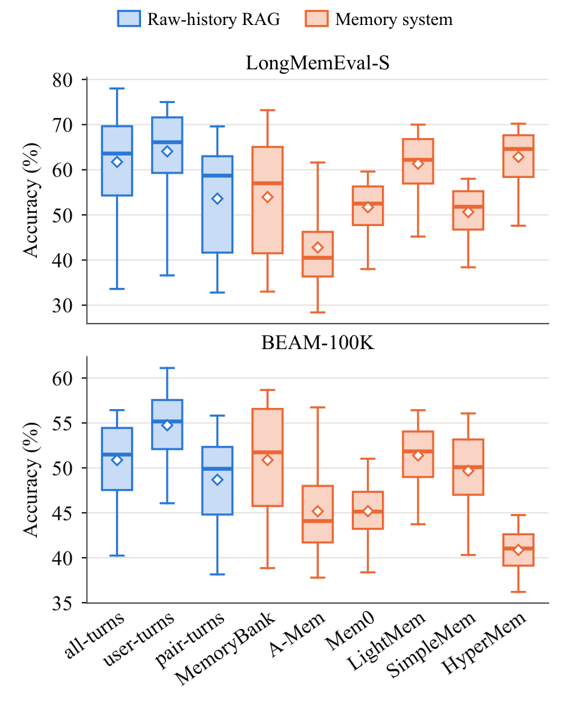
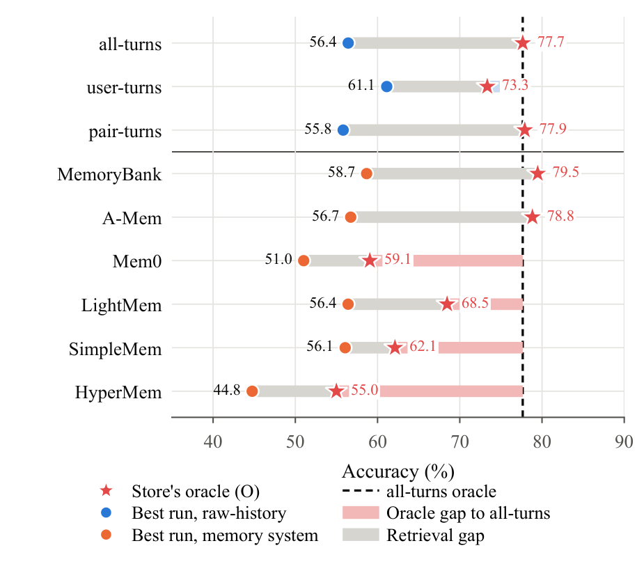

# Memory Systems vs. RAG

[](https://arxiv.org/abs/2610.24671)
[](https://huggingface.co/papers/2610.24671)
[](https://www.alphaxiv.org/abs/2610.24671)
[](LICENSE)

Code for the paper **[Do Conversational Agents Need Explicit Memory? A Controlled Comparison with
Raw-History Retrieval](https://arxiv.org/abs/2610.24671)**, by Yongjie Zhou, Shuai Wang, Bevan Koopman and
Guido Zuccon.

Six explicit memory systems (MemoryBank, A-Mem, Mem0, LightMem, SimpleMem, HyperMem) against
raw-history RAG (*all-turns*, *user-turns*, *pair-turns*) on **LongMemEval-S** and **BEAM-100K**,
under their original configurations, under controlled retrievers and context budgets, and with
oracle retrieval. **Explicit memory gives no consistent overall advantage over strong
raw-history RAG.** Some systems lose evidence while building memory; others keep it but fail to
retrieve it.

[Results](#results) · [Repository guide](#repository-guide) · [Reproduction](#reproduction) ·
[Citation](#citation)


## Results

- **RQ1–2.** No memory system beats raw-history RAG consistently, either as published or with the
  retriever and context budget held equal. Gains are limited to some question types and tight
  budgets.
- **RQ3.** Oracle retrieval on BEAM-100K shows two bottlenecks: Mem0, LightMem, SimpleMem and HyperMem lose
  evidence during construction; MemoryBank and A-Mem keep it, but their retrieval misses it.
- **RQ4.** Construction takes up to 215 min per conversation (A-Mem, LongMemEval-S), and the
  extra computation does not consistently buy accuracy.

**RQ1: accuracy (%) under original system configurations.** Answers come from
Qwen3-30B-A3B-Instruct-2507 and are judged by GPT-4o mini.

| Method | Retrieval | LME-S | BEAM |
|---|---|---:|---:|
| Full context | — | 22.2 | 24.4 |
| *Raw-history RAG (unified prompt)* | | | |
| *all-turns* | dense (MiniLM) | 63.2 | **56.2** |
| | dense (Qwen3-Emb-0.6B) | **78.0** | 56.0 |
| *user-turns* | dense (MiniLM) | 65.6 | 54.8 |
| | dense (Qwen3-Emb-0.6B) | 72.0 | 55.9 |
| *pair-turns* | dense (MiniLM) | 62.8 | 52.3 |
| | dense (Qwen3-Emb-0.6B) | 63.8 | 53.2 |
| *Explicit memory systems* | | | |
| MemoryBank† | dense + regrouping | 56.2 | 53.9 |
| A-Mem | LLM + dense + links | 47.4 | 33.5 |
| Mem0† | dense (MiniLM) | 57.0 | 42.7 |
| LightMem | dense (MiniLM) | 64.0 | 51.5 |
| SimpleMem | LLM + hybrid + reflection | 46.4 | 29.0 |
| HyperMem | hybrid + reranking | 61.8 | 40.1 |

† uses the unified answer prompt (the system defines none of its own).

<table>
<tr>
<td width="50%"></td>
<td width="50%"></td>
</tr>
<tr>
<td><b>RQ2.</b> Accuracy over 64 configurations per method (8 retrievers × 8 context budgets).
Boxes show the interquartile range and median, diamonds the mean.</td>
<td><b>RQ3.</b> Oracle (★) versus best retrieved (●) accuracy on BEAM-100K. Grey bars are the
retrieval gap; pink bars are the oracle gap to <i>all-turns</i>.</td>
</tr>
</table>

<details>
<summary><b>RQ4: cost versus accuracy</b></summary>

Construction is wall time per conversation; query tokens are LLM
input and output per question, summed over retrieval and answering. Raw-history RAG rows use
Qwen3-Emb-0.6B.

| Method | LME-S<br>construction (min) | LME-S<br>query tokens (k) | LME-S<br>acc. (%) | BEAM<br>construction (min) | BEAM<br>query tokens (k) | BEAM<br>acc. (%) |
|---|---:|---:|---:|---:|---:|---:|
| Full context | 0 | 95.7 | 22.2 | 0 | 96.3 | 24.4 |
| *all-turns* | 0 | 1.8 | **78.0** | 0 | 3.9 | **56.0** |
| *user-turns* | 0 | 1.1 | 72.0 | 0 | 1.7 | 55.9 |
| *pair-turns* | 0 | 4.7 | 63.8 | 0 | 10.2 | 53.2 |
| MemoryBank | 8.3 | 3.2 | 56.2 | 0.9 | 6.2 | 53.9 |
| A-Mem | 215.1 | 15.8 | 47.4 | 116.2 | 27.0 | 33.5 |
| Mem0 | 41.7 | 7.0 | 57.0 | 25.6 | 0.6 | 42.7 |
| LightMem | 6.2 | 0.7 | 64.0 | 3.6 | 1.0 | 51.5 |
| SimpleMem | 24.4 | 14.5 | 46.4 | 11.1 | 15.4 | 29.0 |
| HyperMem | 87.9 | 9.2 | 61.8 | 7.3 | 7.0 | 40.1 |

</details>

Per-question-type results, the other answer generators, and the full cost breakdown (LLM calls,
tokens and latency per stage) are in the paper.

## Repository guide

| Path | Contents |
|---|---|
| [evalgrid/](evalgrid/) | pipeline stages, dataset adapters, retrievers, judges, system adapters, per-system configs |
| [experiments/](experiments/) | one YAML spec per (system, dataset), and the `run_all_*.sh` drivers |
| [scripts/](scripts/) | shell drivers that start vLLM themselves: ingest, RQ1 query, RQ2 grid, RQ3 oracle |
| [vendor/](vendor/) | upstream code of the six systems; pins and local changes in [VERSIONS.md](vendor/VERSIONS.md) |

[Design.md](Design.md) explains how the code is organised: the plugin contract, how each paper
condition maps to the code, and the output layout.

## Reproduction

Install → download data → start servers → build memory → RQ1 → RQ2 → RQ3 → RQ4 → inspect
outputs. Each RQ ends by judging its answers. Each step names the paper table or figure it produces, and RQ1 and RQ3 give the numbers
to expect. Run everything from the repo root; logs go to `logs/`.

### 1. Install

```bash
conda create -n memgrid python=3.11 -y && conda activate memgrid
pip install --no-deps -r requirements.txt      # pip freeze of the run environment (CUDA 12.8)
python -c "import nltk; nltk.download('punkt_tab'); nltk.download('stopwords')"   # HyperMem
cp .env.example .env                           # OPENAI_API_KEY: judge and GPT generators
hf auth login                                  # SPLADE-v3 is gated
```

`--no-deps` is needed because the file pins every transitive dependency. Install vLLM 0.22.1 in
a separate environment and put its `vllm` on `PATH`.

### 2. Download data

The adapters read these exact paths:

```bash
hf download xiaowu0162/longmemeval-cleaned longmemeval_s_cleaned.json \
    --repo-type dataset --local-dir data/LongMemEval      # data/LongMemEval/longmemeval_s_cleaned.json

hf download Mohammadta/BEAM --repo-type dataset --local-dir data/BEAM
                                                          # data/BEAM/data/100K-00000-of-00001.parquet
python -m evalgrid.tools.dataset_stats --dataset longmemeval_s --summary
# expected: 500 instances, 51.53M tokens, 896 evidence turns
```

### 3. Start the servers

By default, `Qwen/Qwen3-30B-A3B-Instruct-2507` builds memory and answers, and `gpt-4o-mini`
(OpenAI Batch API) judges; the table below lists the exceptions. One 80 GB GPU is enough.

- **`scripts/`** (memory systems) start and stop vLLM themselves, at the context window each step
  needs. Pass `SKIP_SERVER=1` to use servers you already started.
- **`experiments/run_all_*.sh`** (raw-history RAG) start nothing. Retrieval needs only the
  embedders and answering only the generator, so run them one after the other:

  ```bash
  # before run_all_retrieval.sh
  vllm serve Qwen/Qwen3-Embedding-0.6B --port 8001 --gpu-memory-utilization 0.1 &
  vllm serve Qwen/Qwen3-Embedding-4B   --port 8002 --gpu-memory-utilization 0.25 &
  # before run_all_answers.sh (stop the embedders first)
  # 131,072 tokens is needed for full context only
  vllm serve Qwen/Qwen3-30B-A3B-Instruct-2507 \
      --port 8000 \
      --max-model-len 131072 \
      --gpu-memory-utilization 0.95
  ```

BM25, SPLADE, MiniLM and SimpleMem's embedder run in-process. If 131,072 tokens do not fit, see
[scripts/README.md](scripts/README.md#servers).

<details>
<summary><b>All models and generation settings</b></summary>

All models the paper uses, by pipeline stage. A **default** model is used for every result unless
another row in its stage says otherwise.

**Construction**: turns the conversation history into memory (memory systems only).

| Role | Model | Paper |
|---|---|---|
| Construction LLM (**default**) | `Qwen/Qwen3-30B-A3B-Instruct-2507` | all results |
| Construction LLM, alternative | `gpt-4o-mini`, all six systems on BEAM-100K | Table 5 |

**Retrieval**: selects memory units or raw turns for a question.

| Role | Model | Paper |
|---|---|---|
| Query-time memory LLM (**default**) | `Qwen/Qwen3-30B-A3B-Instruct-2507`, for A-Mem's keyword query and SimpleMem's query plan and reflection | all results |
| Each system's own retriever | MemoryBank, A-Mem, Mem0, LightMem: `all-MiniLM-L6-v2`<br>SimpleMem: `Qwen3-Embedding-0.6B`, plus keyword and SQL search<br>HyperMem: RRF of BM25 and `Qwen3-Embedding-4B`, reranked by `Qwen3-Reranker-4B` | Table 1 |
| Raw-history RAG retrievers | `all-MiniLM-L6-v2`, `Qwen3-Embedding-0.6B` | Table 1 |
| Retriever grid, all methods | BM25, `naver/splade-v3`, `all-MiniLM-L6-v2`, `Qwen3-Embedding-0.6B`, `Qwen3-Embedding-4B`, and RRF of BM25 with each dense model | Figures 2–3 |

**Answering**: generates the answer from the retrieved context.

| Role | Model | Paper |
|---|---|---|
| Answer generator (**default**) | `Qwen/Qwen3-30B-A3B-Instruct-2507` | all results |
| Other generators | `Qwen/Qwen3-1.7B`, `Qwen/Qwen3-8B`, `gpt-5-nano` (snapshot 2025-08-07) | Figure 4 |
| | `Qwen/Qwen3-4B-Instruct-2507`, `Qwen/Qwen3-32B`, `google/gemma-4-26B-A4B-it`, `gpt-4o-mini` | Figure 6 |

**Judging**: scores each answer.

| Role | Model | Paper |
|---|---|---|
| Judge | `gpt-4o-mini` | all results |

**Where they run.** The open-weight generators are served by vLLM on :8000, the Qwen3
embedders on :8001 (0.6B) and :8002 (4B), and HyperMem's embedder and reranker on the ports in its
config. The GPT models are called through the OpenAI API (Batch API for answers and judging).

All generation uses temperature 0, seed 42 and a 2,000-token output cap. HyperMem's own prompt is
the one exception: it allows 4,096 tokens. GPT-5-nano uses reasoning effort `minimal` and no
temperature. No generator uses thinking mode. The judge uses temperature 0, seed 42 and a
1,024-token cap.

`scripts/` serve the memory model at 131,072 tokens for HyperMem, MemoryBank, Mem0 and A-Mem, and
at 32,768 for LightMem and SimpleMem. The unified-prompt generator gets 131,072.

</details>

### 4. Run the experiments

**Smoke test.** Before a full run, build and query one system on 3 questions:

```bash
SYSTEMS=lightmem \
SPEC_NAME=longmemeval.yaml \
LIMIT=3 \
bash scripts/ingest.sh

SYSTEMS=lightmem \
SPEC_NAME=longmemeval.yaml \
LIMIT=3 \
bash scripts/query.sh
```

**Full runs.** The commands below show one memory system (`lightmem`) and one raw-history
baseline (`all_turns`). Run each one again for the others:

- memory systems: `memorybank`, `a_mem`, `mem0`, `lightmem`, `simplemem`, `hypermem`
- raw-history RAG: `all_turns`, `user_turns`, `pair_turns`

An empty value means the default for a full run: `LIMIT=` runs the whole dataset, and
`NATIVE_TOP_K=` and `MEM_ROOT=` use each system's published depth and `outputs/`.

Pick the dataset once; every command reads these two variables:

```bash
export DS=longmemeval D=longmemeval_s     # or: export DS=beam_100k D=beam_100k
```

#### 4.0 Check the install (no GPU)

```bash
python -m evalgrid.tools.check_system_contract
python -m evalgrid.tools.check_session_source_id
```

#### 4.1 Build memory

This builds the system's store once, then checks it:

```bash
SYSTEMS=lightmem \
SPEC_NAME=$DS.yaml \
LIMIT= \
bash scripts/ingest.sh

python -m evalgrid.tools.check_ingest --exp experiments/lightmem/$DS.yaml
```

Ingest resumes where it stopped. To split a system across N processes or machines, give each one
`NUM_SHARDS=N SHARD_ID=i`.

#### 4.2 RQ1: original configurations (Table 1)

**Memory systems.** Each one runs its own retrieval and answer prompt at its published depth:

```bash
SYSTEMS=lightmem \
SPEC_NAME=$DS.yaml \
NATIVE_TOP_K= \
CONFIG=evalgrid/configs/lightmem/naive_query.yaml \
NATIVE_VARIANT=naive \
PROMPT=native \
LIMIT= \
bash scripts/query.sh
```

HyperMem also needs its embedder and reranker. Name the two servers, using the ports in its config:

```bash
SYSTEMS=hypermem \
SPEC_NAME=$DS.yaml \
EMB_SERVE=Qwen/Qwen3-Embedding-4B@11810 \
RERANK_SERVE=Qwen/Qwen3-Reranker-4B@12810 \
NATIVE_TOP_K= \
CONFIG=evalgrid/configs/hypermem/naive_query.yaml \
NATIVE_VARIANT=naive \
PROMPT=native \
LIMIT= \
bash scripts/query.sh
```

MemoryBank and Mem0 define no answer prompt of their own, so `PROMPT=native` gives them the
unified prompt, as in the paper.

**Raw-history RAG.** Build the corpus (`--roles all`, `user` or `pair` for *all-turns*,
*user-turns* or *pair-turns*), then retrieve and answer top-10 with MiniLM and Qwen3-Emb-0.6B:

```bash
python -m evalgrid.pipeline.qrels_turns --dataset $D --roles all
export SPEC=experiments/all_turns/$DS.yaml
export RETRIEVERS="dense:sentence-transformers/all-MiniLM-L6-v2,dense:Qwen/Qwen3-Embedding-0.6B@http://localhost:8001/v1"
bash experiments/run_all_retrieval.sh
TOP_K_VALUES=10 INCLUDE_ORACLE=0 bash experiments/run_all_answers.sh
```

**Full context.** The generator gets the raw *all-turns* history with no retrieval, capped at the
most recent 100K tokens (`FULL_HISTORY_TOKENS`):

```bash
SPEC=experiments/all_turns/$DS.yaml FULL_ONLY=1 bash experiments/run_all_answers.sh
```

**Judge.** This grades every `predictions.jsonl` under a spec with GPT-4o mini through the Batch
API. Already-judged predictions are skipped, so rerun it freely after later steps (`FORCE=1`
re-judges). Run it for each system:

```bash
SPEC=experiments/lightmem/$DS.yaml BATCH=1 bash experiments/run_all_judge.sh
```

Expect Table 1, e.g. on LongMemEval-S: *all-turns* + Qwen3-Emb-0.6B 78.0,
LightMem 64.0, full context 22.2.

#### 4.3 RQ2: retrievers × context budgets (Figures 2–4 and 6, Table 2)

All runs use the unified answer prompt. There are eight retrievers: BM25, SPLADE-v3, MiniLM,
Qwen3-Emb-0.6B and Qwen3-Emb-4B, plus RRF of BM25 with each dense model. They run against eight
budgets: top-k ∈ {3, 5, 10, 20} and tokens ∈ {200, 500, 1000, 2000}.

**Memory systems.** The eight retrievers plug into the system's own retrieval pipeline; the
second command answers every budget:

```bash
SYS=lightmem \
SPEC_NAME=$DS.yaml \
MEM_ROOT= \
LIMIT= \
bash scripts/native_grid.sh

SYS=lightmem \
SPEC_NAME=$DS.yaml \
MEM_ROOT= \
STAGE=answer \
ANSWER_CELLS=top3+top5+top10+top20+budget200+budget500+budget1000+budget2000 \
LIMIT= \
bash scripts/native_grid.sh
```

**Raw-history RAG.** The specs list the same eight retrievers:

```bash
unset RETRIEVERS
export SPEC=experiments/all_turns/$DS.yaml
bash experiments/run_all_retrieval.sh
TOP_K_VALUES=3,5,10,20 INCLUDE_ORACLE=0 bash experiments/run_all_answers.sh
CONTEXT_BUDGETS=200,500,1000,2000 INCLUDE_ORACLE=0 bash experiments/run_all_answers.sh
```

**Other answer generators (Figures 4 and 6).** These runs keep Qwen3-Emb-0.6B as the retriever
and use the four token budgets.

- **vLLM models** (Qwen3-1.7B, Qwen3-8B, Qwen3-4B-Instruct-2507, Qwen3-32B, Gemma-4-26B-A4B): set
  `GEN_MODEL`, and serve the model at its window: 40,960 for Qwen3-1.7B/8B, 32,768 for Qwen3-32B,
  131,072 for the others. Example with Qwen3-8B:

  ```bash
  # memory systems (the script serves the generator)
  SYS=lightmem \
  SPEC_NAME=$DS.yaml \
  GEN_MODEL=Qwen/Qwen3-8B \
  MAX_MODEL_LEN=40960 \
  MEM_ROOT= \
  STAGE=answer \
  GRID_RETRIEVERS=dense:Qwen/Qwen3-Embedding-0.6B@http://localhost:8001/v1 \
  ANSWER_CELLS=budget200+budget500+budget1000+budget2000 \
  LIMIT= \
  bash scripts/native_grid.sh

  # raw-history RAG (serve the generator on :8000 yourself)
  SPEC=experiments/all_turns/$DS.yaml \
  GEN_MODEL=Qwen/Qwen3-8B \
  CONTEXT_WINDOW=40960 \
  INCLUDE_ORACLE=0 \
  RETRIEVERS=dense:Qwen/Qwen3-Embedding-0.6B@http://localhost:8001/v1 \
  CONTEXT_BUDGETS=200,500,1000,2000 \
  bash experiments/run_all_answers.sh
  ```

- **OpenAI models** (GPT-5-nano, GPT-4o mini): `clone_answer_cells` reads each Qwen3-8B cell's
  recorded settings, swaps only the generator, and answers through the Batch API. Run the Qwen3-8B
  cells first.

  ```bash
  python -m evalgrid.tools.clone_answer_cells --gen-model gpt-5-nano --gen-reasoning-effort minimal --phase both
  python -m evalgrid.tools.clone_answer_cells --gen-model gpt-4o-mini --phase both
  ```

**Judge** each system, as in RQ1:

```bash
SPEC=experiments/lightmem/$DS.yaml BATCH=1 bash experiments/run_all_judge.sh
```

#### 4.4 RQ3: oracle retrieval (Figure 5)

BEAM-100K only. The gold units of each store go straight to the generator. The first command
covers all six memory systems:

```bash
SPEC_NAME=beam_100k.yaml bash scripts/oracle.sh
SPEC=experiments/all_turns/beam_100k.yaml ORACLE_ONLY=1 bash experiments/run_all_answers.sh
```

**Judge** each system, as in RQ1:

```bash
SPEC=experiments/lightmem/beam_100k.yaml BATCH=1 bash experiments/run_all_judge.sh
```

Expected oracle accuracy (Figure 5): *all-turns* 77.7, MemoryBank 79.5, A-Mem 78.8, LightMem
68.5, SimpleMem 62.1, Mem0 59.1, HyperMem 55.0.

#### 4.5 RQ4: cost (Table 3)

No extra runs. Every ingest, retrieval and answer step above records its LLM calls, tokens and
wall time (files in [5. Inspect outputs](#5-inspect-outputs)). If any run was resumed, check the
recorded totals before building the table:

```bash
python -m evalgrid.tools.check_usage outputs
```

#### 4.6 Appendix: construction-model check (Appendix B.2, Table 5)

Each system's memory on BEAM-100K is rebuilt with GPT-4o mini, then queried under the RQ1 setup.
Only the construction model changes: query-time calls and answers still use Qwen3-30B-A3B.
`MEM_VARIANT` tags the output directories. For HyperMem, add the `EMB_SERVE` and `RERANK_SERVE`
settings from 4.2 to the query command.

```bash
SYSTEM=lightmem \
SPEC_NAME=beam_100k.yaml \
MEM_MODEL=gpt-4o-mini \
MEM_ROOT=outputs/_memory/gpt-4o-mini \
LIMIT= \
bash scripts/ingest_openai.sh

SYSTEMS=lightmem \
SPEC_NAME=beam_100k.yaml \
MEM_ROOT=outputs/_memory/gpt-4o-mini \
MEM_VARIANT=ingest-gpt-4o-mini \
NATIVE_TOP_K= \
CONFIG=evalgrid/configs/lightmem/naive_query.yaml \
NATIVE_VARIANT=naive \
PROMPT=native \
LIMIT= \
bash scripts/query.sh
```

Stores go to `outputs/_memory/gpt-4o-mini/<sys>/`, and results go beside them in
`outputs/_memory/gpt-4o-mini/_answers/`. Judge them with
`python -m evalgrid.pipeline.judge --predictions <predictions.jsonl> --dataset beam_100k --batch`.

### 5. Inspect outputs

| Metric | File |
|---|---|
| Accuracy (BEAM: mean rubric score) | `outputs/_answers/**/metrics.gpt-4o-mini.json` |
| Retrieval recall / NDCG@k | `outputs/_eval/**/metrics-gold-turn.json` |
| Construction cost (RQ4) | `outputs/_memory/**/ingest_usage.json` |
| Query-time cost, context size (RQ4) | `answer_summary.json` and `answer_stats.jsonl` in each answer cell |

To confirm every stage finished, run `python -m evalgrid.tools.check_grid` and
`python -m evalgrid.tools.check_judge` (add `--spec-name beam_100k.yaml` for BEAM-100K).

### Notes

- All 500 LongMemEval-S questions are used. Keep `EXCLUDE_QUESTION_TYPES` empty.
- Every system receives both speakers' turns. LightMem then drops the assistant side internally,
  as published.
- Upstream code is changed only where [vendor/VERSIONS.md](vendor/VERSIONS.md) lists it. All other
  adaptations are in the adapters under `evalgrid/systems/`.

## License

This repository's own code is MIT-licensed ([LICENSE](LICENSE)).
Each system in `vendor/` keeps its upstream licence (`vendor/<system>/LICENSE`): MIT for
LightMem, A-Mem, SimpleMem and MemoryBank, Apache-2.0 for HyperMem and Mem0.

## Citation

If you use this code or our results, please cite:

```bibtex
@misc{zhou2026explicitmemory,
  title         = {Do Conversational Agents Need Explicit Memory? A Controlled Comparison with Raw-History Retrieval},
  author        = {Zhou, Yongjie and Wang, Shuai and Koopman, Bevan and Zuccon, Guido},
  year          = {2026},
  eprint        = {2610.24671},
  archivePrefix = {arXiv},
  url           = {https://arxiv.org/abs/2610.24671}
}
```
