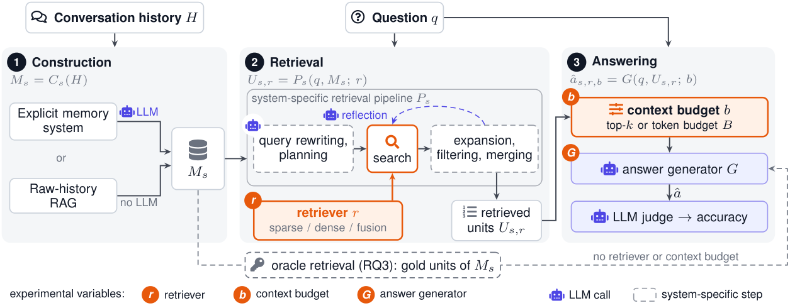

# Memory Systems vs. RAG

[](https://arxiv.org/abs/2610.24671)
[](LICENSE)

Code to reproduce the paper's experiments: six explicit memory systems (MemoryBank, A-Mem, Mem0,
LightMem, SimpleMem, HyperMem) against raw-history RAG (*all-turns*, *user-turns*, *pair-turns*)
on **LongMemEval-S** and **BEAM-100K**.



| Path | Contents |
|---|---|
| [evalgrid/](evalgrid/) | pipeline stages, dataset adapters, retrievers, judges, system adapters, per-system configs |
| [experiments/](experiments/) | one YAML spec per (system, dataset), and the `run_all_*.sh` drivers |
| [scripts/](scripts/) | shell drivers that start vLLM themselves: ingest, RQ1 query, RQ2 grid, RQ3 oracle |
| [vendor/](vendor/) | upstream code of the six systems; pins and local changes in [VERSIONS.md](vendor/VERSIONS.md) |

[Design.md](Design.md) explains how the code is organised: the plugin contract, how each paper
condition maps to the code, and the output layout.

## Setup

```bash
conda create -n memgrid python=3.11 -y && conda activate memgrid
pip install --no-deps -r requirements.txt      # pip freeze of the run environment (CUDA 12.8)
python -c "import nltk; nltk.download('punkt_tab'); nltk.download('stopwords')"   # HyperMem
cp .env.example .env                           # OPENAI_API_KEY: judge and GPT generators
hf auth login                                  # SPLADE-v3 is gated
```

`--no-deps` is needed because the file pins every transitive dependency. Install vLLM 0.22.1 in
a separate environment and put its `vllm` on `PATH`.

**Data.** The adapters read these exact paths:

```bash
hf download xiaowu0162/longmemeval-cleaned longmemeval_s_cleaned.json \
    --repo-type dataset --local-dir data/LongMemEval      # data/LongMemEval/longmemeval_s_cleaned.json
hf download Mohammadta/BEAM --repo-type dataset --local-dir data/BEAM
                                                          # data/BEAM/data/100K-00000-of-00001.parquet
python -m evalgrid.tools.dataset_stats --dataset longmemeval_s --summary
# expected: 500 instances, 51.53M tokens, 896 evidence turns
```

## Models

All models the paper uses, by pipeline stage. A **default** model is used for every result unless
another row in its stage says otherwise.

**1. Construction**: turns the conversation history into memory (memory systems only).

| Role | Model | Paper |
|---|---|---|
| Construction LLM (**default**) | `Qwen/Qwen3-30B-A3B-Instruct-2507` | all results |
| Construction LLM, alternative | `gpt-4o-mini`, all six systems on BEAM-100K | Table 5 |

**2. Retrieval**: selects memory units or raw turns for a question.

| Role | Model | Paper |
|---|---|---|
| Query-time memory LLM (**default**) | `Qwen/Qwen3-30B-A3B-Instruct-2507`, for A-Mem's keyword query and SimpleMem's query plan and reflection | all results |
| Each system's own retriever | MemoryBank, A-Mem, Mem0, LightMem: `all-MiniLM-L6-v2`<br>SimpleMem: `Qwen3-Embedding-0.6B`, plus keyword and SQL search<br>HyperMem: RRF of BM25 and `Qwen3-Embedding-4B`, reranked by `Qwen3-Reranker-4B` | Table 1 |
| Raw-history RAG retrievers | `all-MiniLM-L6-v2`, `Qwen3-Embedding-0.6B` | Table 1 |
| Retriever grid, all methods | BM25, `naver/splade-v3`, `all-MiniLM-L6-v2`, `Qwen3-Embedding-0.6B`, `Qwen3-Embedding-4B`, and RRF of BM25 with each dense model | Figures 2–3 |

**3. Answering**: generates the answer from the retrieved context.

| Role | Model | Paper |
|---|---|---|
| Answer generator (**default**) | `Qwen/Qwen3-30B-A3B-Instruct-2507` | all results |
| Other generators | `Qwen/Qwen3-1.7B`, `Qwen/Qwen3-8B`, `gpt-5-nano` (snapshot 2025-08-07) | Figure 4 |
| | `Qwen/Qwen3-4B-Instruct-2507`, `Qwen/Qwen3-32B`, `google/gemma-4-26B-A4B-it`, `gpt-4o-mini` | Figure 6 |

**4. Judging**: scores each answer.

| Role | Model | Paper |
|---|---|---|
| Judge | `gpt-4o-mini` | all results |

**Where they run.** Qwen3-30B-A3B and the other open-weight generators are served by vLLM on
:8000. The Qwen3 embedders are served on :8001 (0.6B) and :8002 (4B), and HyperMem's embedder and
reranker on the ports in its config. BM25, SPLADE, MiniLM and SimpleMem's embedder
run in-process. The GPT models are called through the OpenAI API (Batch API for answers and
judging).

All generation uses temperature 0, seed 42 and a 2,000-token output cap. HyperMem's own prompt is
the one exception: it allows 4,096 tokens. GPT-5-nano uses reasoning effort `minimal` and no
temperature. No generator uses thinking mode.
The judge uses temperature 0, seed 42 and a 1,024-token cap.

Two ways of starting servers:
- **`scripts/`** start and stop vLLM themselves, at the context window each step needs. The
  memory model gets 131,072 tokens for HyperMem, MemoryBank, Mem0 and A-Mem, and 32,768 for
  LightMem and SimpleMem. The unified-prompt generator gets 131,072. Pass `SKIP_SERVER=1` to use
  endpoints you already started.
- **`experiments/run_all_*.sh`** start nothing. Serve the generator on :8000 (with
  `--max-model-len 131072` for full-context) and the embedders on :8001 / :8002 first.

One 80 GB GPU is enough.

## Reproduce

Run from the repo root. Set `DS=longmemeval` or `DS=beam_100k`, and `D` to the matching dataset
key (`longmemeval_s` / `beam_100k`). Logs go to `logs/`.

**0. Check the install** (no GPU):

```bash
python -m evalgrid.tools.check_system_contract
python -m evalgrid.tools.check_session_source_id
```

**1. Construct memory.** This builds each system's store once, then checks it:

```bash
for SYS in memorybank a_mem mem0 lightmem simplemem hypermem; do
  SYSTEMS=$SYS LIMIT= SPEC_NAME=$DS.yaml bash scripts/ingest.sh
  python -m evalgrid.tools.check_ingest --exp experiments/$SYS/$DS.yaml
done
```

Ingest resumes where it stopped. To split a system across N processes or machines, give each one
`NUM_SHARDS=N SHARD_ID=i`.

**2. RQ1: original configurations.** Each memory system runs its own retrieval and answer prompt
at its published depth:

```bash
for SYS in memorybank a_mem mem0 lightmem simplemem; do
  NATIVE_TOP_K= CONFIG=evalgrid/configs/$SYS/naive_query.yaml NATIVE_VARIANT=naive PROMPT=native \
    SYSTEMS=$SYS SPEC_NAME=$DS.yaml LIMIT= bash scripts/query.sh
done
```

HyperMem's own pipeline also needs its embedder and reranker. Run it with the two servers named,
using the ports in its config:

```bash
EMB_SERVE=Qwen/Qwen3-Embedding-4B@11810 RERANK_SERVE=Qwen/Qwen3-Reranker-4B@12810 \
  NATIVE_TOP_K= CONFIG=evalgrid/configs/hypermem/naive_query.yaml NATIVE_VARIANT=naive PROMPT=native \
  SYSTEMS=hypermem SPEC_NAME=$DS.yaml LIMIT= bash scripts/query.sh
```

MemoryBank and Mem0 define no answer prompt of their own, so `PROMPT=native` gives them the
unified prompt, as in the paper.

Raw-history RAG: build each corpus, then retrieve and answer top-10 with MiniLM and
Qwen3-Embedding-0.6B:

```bash
for R in all user pair; do python -m evalgrid.pipeline.qrels_turns --dataset $D --roles $R; done
for SYS in all_turns user_turns pair_turns; do
  export SPEC=experiments/$SYS/$DS.yaml
  export RETRIEVERS="dense:sentence-transformers/all-MiniLM-L6-v2,dense:Qwen/Qwen3-Embedding-0.6B@http://localhost:8001/v1"
  bash experiments/run_all_retrieval.sh
  TOP_K_VALUES=10 INCLUDE_ORACLE=0 bash experiments/run_all_answers.sh
done
```

Full-context gives the generator the raw *all-turns* history with no retrieval. The history is
capped at 100K tokens, keeping the most recent turns that fit (`FULL_HISTORY_TOKENS`, default
100000):

```bash
SPEC=experiments/all_turns/$DS.yaml FULL_ONLY=1 bash experiments/run_all_answers.sh
```

**3. RQ2: retrievers × context budgets**, under the unified answer prompt. There are eight
retrievers: BM25, SPLADE-v3, MiniLM, Qwen3-Emb-0.6B and Qwen3-Emb-4B, plus RRF of BM25 with each
dense model. They run against eight budgets: top-k ∈ {3, 5, 10, 20} and tokens ∈ {200, 500,
1000, 2000}.

```bash
CELLS=top3+top5+top10+top20+budget200+budget500+budget1000+budget2000

# memory systems: the eight retrievers plugged into each system's own retrieval pipeline
for SYS in memorybank a_mem mem0 lightmem simplemem hypermem; do
  SYS=$SYS SPEC_NAME=$DS.yaml MEM_ROOT= LIMIT= bash scripts/native_grid.sh
  SYS=$SYS SPEC_NAME=$DS.yaml MEM_ROOT= LIMIT= STAGE=answer ANSWER_CELLS=$CELLS \
    bash scripts/native_grid.sh
done

# raw-history RAG (the specs list the same eight retrievers)
unset RETRIEVERS
for SYS in all_turns user_turns pair_turns; do
  export SPEC=experiments/$SYS/$DS.yaml
  bash experiments/run_all_retrieval.sh
  TOP_K_VALUES=3,5,10,20 INCLUDE_ORACLE=0 bash experiments/run_all_answers.sh
  CONTEXT_BUDGETS=200,500,1000,2000 INCLUDE_ORACLE=0 bash experiments/run_all_answers.sh
done
```

**Other answer generators.** These runs keep Qwen3-Embedding-0.6B as the retriever and use the
four token budgets.

- **vLLM models** (Qwen3-1.7B, Qwen3-8B, Qwen3-4B-Instruct-2507, Qwen3-32B, Gemma-4-26B-A4B): set
  `GEN_MODEL`, and serve the model at its window: 40,960 for Qwen3-1.7B/8B, 32,768 for Qwen3-32B,
  131,072 for the others.

  ```bash
  # memory systems (the script serves the generator)
  GEN_MODEL=Qwen/Qwen3-8B MAX_MODEL_LEN=40960 SYS=$SYS SPEC_NAME=$DS.yaml MEM_ROOT= LIMIT= STAGE=answer \
    GRID_RETRIEVERS=dense:Qwen/Qwen3-Embedding-0.6B@http://localhost:8001/v1 \
    ANSWER_CELLS=budget200+budget500+budget1000+budget2000 bash scripts/native_grid.sh
  # raw-history RAG (serve the generator on :8000 yourself)
  SPEC=experiments/$SYS/$DS.yaml GEN_MODEL=Qwen/Qwen3-8B CONTEXT_WINDOW=40960 INCLUDE_ORACLE=0 \
    RETRIEVERS=dense:Qwen/Qwen3-Embedding-0.6B@http://localhost:8001/v1 \
    CONTEXT_BUDGETS=200,500,1000,2000 bash experiments/run_all_answers.sh
  ```

- **OpenAI models** (GPT-5-nano, GPT-4o mini): `clone_answer_cells` reads each Qwen3-8B cell's
  recorded settings, swaps only the generator, and answers through the Batch API. Run the Qwen3-8B
  cells first.

  ```bash
  python -m evalgrid.tools.clone_answer_cells --gen-model gpt-5-nano --gen-reasoning-effort minimal --phase both
  python -m evalgrid.tools.clone_answer_cells --gen-model gpt-4o-mini --phase both
  ```

**4. RQ3: oracle retrieval** on BEAM-100K. The gold units of each store go straight to the
generator:

```bash
SPEC_NAME=beam_100k.yaml bash scripts/oracle.sh                     # six memory systems
for SYS in all_turns user_turns pair_turns; do
  SPEC=experiments/$SYS/beam_100k.yaml ORACLE_ONLY=1 bash experiments/run_all_answers.sh
done
```

**5. Judge.** This grades every `predictions.jsonl` under a spec with GPT-4o mini through the Batch
API:

```bash
for SYS in memorybank a_mem mem0 lightmem simplemem hypermem all_turns user_turns pair_turns; do
  SPEC=experiments/$SYS/$DS.yaml BATCH=1 bash experiments/run_all_judge.sh
done
```

**6. Construction-model check (Appendix B.2, Table 5).** Each system's memory on BEAM-100K is
rebuilt with GPT-4o mini, then queried under the RQ1 setup. Only the construction model changes:
query-time calls and answers still use Qwen3-30B-A3B. `MEM_VARIANT` tags the output directories.

```bash
ROOT=outputs/_memory/gpt-4o-mini
for SYS in memorybank a_mem mem0 lightmem simplemem hypermem; do
  SYSTEM=$SYS SPEC_NAME=beam_100k.yaml MEM_MODEL=gpt-4o-mini MEM_ROOT=$ROOT LIMIT= \
    bash scripts/ingest_openai.sh
done
for SYS in memorybank a_mem mem0 lightmem simplemem hypermem; do
  EXTRA=(); [[ $SYS == hypermem ]] && EXTRA=(EMB_SERVE=Qwen/Qwen3-Embedding-4B@11810 RERANK_SERVE=Qwen/Qwen3-Reranker-4B@12810)
  env "${EXTRA[@]}" SYSTEMS=$SYS MEM_ROOT=$ROOT MEM_VARIANT=ingest-gpt-4o-mini \
    NATIVE_TOP_K= CONFIG=evalgrid/configs/$SYS/naive_query.yaml NATIVE_VARIANT=naive PROMPT=native \
    SPEC_NAME=beam_100k.yaml LIMIT= bash scripts/query.sh
done
```

Stores go to `$ROOT/<sys>/`, and results go beside them in `$ROOT/_answers/`. Judge them with
`python -m evalgrid.pipeline.judge --predictions <predictions.jsonl> --dataset beam_100k --batch`.

## Results

| Metric | File |
|---|---|
| Accuracy (BEAM: mean rubric score) | `outputs/_answers/**/metrics.gpt-4o-mini.json` |
| Retrieval recall / NDCG@k | `outputs/_eval/**/metrics-gold-turn.json` |
| Construction cost (RQ4) | `outputs/_memory/**/ingest_usage.json` |
| Query-time cost, context size (RQ4) | `answer_summary.json` and `answer_stats.jsonl` in each answer cell |

To confirm every stage finished, run `python -m evalgrid.tools.check_grid` and
`python -m evalgrid.tools.check_judge` (add `--spec-name beam_100k.yaml` for BEAM-100K).

## Notes

- All 500 LongMemEval-S questions are used. Keep `EXCLUDE_QUESTION_TYPES` empty.
- Every system receives both speakers' turns. LightMem then drops the assistant side internally,
  as published.
- Upstream code is changed only where [vendor/VERSIONS.md](vendor/VERSIONS.md) lists it. All other
  adaptations are in the adapters under `evalgrid/systems/`.
- This repository's own code is MIT-licensed ([LICENSE](LICENSE)).
- Each system in `vendor/` keeps its upstream licence (`vendor/<system>/LICENSE`): MIT for
  LightMem, A-Mem, SimpleMem and MemoryBank, Apache-2.0 for HyperMem and Mem0.
